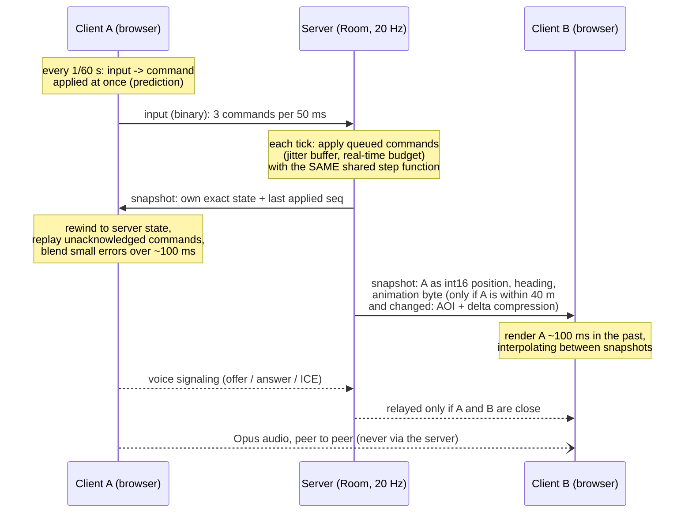

# Shoreline

A stylized 3D beach world in the browser where players meet, walk around together, chat and talk by
voice with whoever is standing near them. Everything you see (terrain, water, props, characters) is built
procedurally in code. It also runs fully offline as a single-player game.

**Monorepo (pnpm + Turborepo)**

| Package | What |
|---|---|
| `apps/web` | the client: Vite + React 18 + TypeScript, three.js via React Three Fiber, Zustand, Tailwind |
| `apps/server` | the authoritative game server: Fastify 5, `@fastify/websocket`, zod, pino |
| `packages/shared` | pure TypeScript shared by both: protocol, zod schemas, the movement simulation, collision, map data |
| `packages/config` | the one tsconfig, ESLint and Prettier config |
| `infra/` | coturn (TURN/STUN) for voice across networks, docker-compose |

## Run locally

Requirements: Node 22+, and pnpm through Corepack (`corepack enable`; the version is pinned in `package.json`).

```bash
pnpm install
pnpm dev          # game server (tsx watch, port 8787) + web app (Vite, http://localhost:5173)
```

Open http://localhost:5173 in two browser windows, pick a name, keep **Online** and the same room, and
enter. The web dev server proxies `/ws` and `/api` to the game server, so there is nothing else to set up.
Without the server (or with **Offline** chosen), the game runs single-player exactly as before.

```bash
pnpm build        # everything (turbo, cached): shared (tsup) -> server bundle + web bundle
pnpm typecheck
pnpm lint         # zero warnings allowed
pnpm test         # unit tests (shared), server integration tests
pnpm format       # Prettier
```

Docker is only needed for voice between different networks: `docker compose -f infra/docker-compose.yml up coturn`.

**Controls:** WASD / arrows move (relative to the camera), Shift runs, click/tap to walk, right-drag or Q/E
rotates the camera, wheel/pinch zooms, F / Space / Enter interacts. **T** chat, **1 2 3** wave / dance /
sit, **M** mute, hold **V** push-to-talk (when enabled), **right-click a player** for volume / mute / block.

## Architecture



- **One simulation, two places.** `packages/shared` holds the movement step, collision grid and map data.
  The client predicts with it and the server is the authority with it. Inputs are quantized before use on
  both sides, so for the same commands both compute bit-identical positions (there is a test for that).
- **The server trusts nothing positional.** Clients send only input commands (direction, run, camera
  yaw); `dt` is fixed and implied, so it can't be used for speed hacks. The server applies at most real
  time plus a small burst of commands, uses the same collision (no walking into deep water or props),
  validates names and avatars (zod + whitelist), rate-limits every message type and caps message size.
- **Rooms.** One room per map instance, created on first join and closed when empty, 50 players by
  default. Each client only receives players within 40 m (spawn/despawn as they enter and leave), and
  only those whose quantized state changed.
- **Reconnects.** Ping/pong heartbeat. A dropped player stays for 10 s and resumes with the same id and
  position (a page refresh too; the token is per tab). A second tab with the same token takes over.
- **Voice.** WebRTC mesh between players within 12 m (dropped beyond 15 m), the nearest 6 (3 to 4 on
  low tiers). Signaling goes through the game socket and the server checks the distance. Audio is
  spatialized with Web Audio (distance falloff, panning relative to the camera). TURN credentials are
  short-lived (HMAC, TURN REST API) and come in the `welcome` message.

Details: [`docs/multiplayer-plan.md`](docs/multiplayer-plan.md) (protocol table, design) and
[`docs/multiplayer-report.md`](docs/multiplayer-report.md) (measured numbers, known limitations).

```
apps/web/src/game/net/       WebSocketAdapter, session, remote entity store (interpolation), emotes
apps/web/src/voice/          VoiceAdapter, MeshVoiceAdapter, LiveKit stub, spatial audio + speaking detection
apps/web/src/ui/             landing (room picker), HUD (status, chat, emotes, voice, player menu)
apps/server/src/             app (HTTP + WS), env, rooms/ (RoomManager, Room, ServerPlayer, spawn), store/, voice/turn
packages/shared/src/         types, avatar catalog, config, map/ (beach, vinland, decks, props, pier),
                             sim/ (collision, step, commands, prediction), net/ (constants, codec, messages, text)
```

## Testing

```bash
pnpm test                                   # 22 server + 18 shared tests (incl. determinism, anti-cheat, AOI)
pnpm --filter @shoreline/server loadtest -- --bots 100 --seconds 60
cd apps/web
node scripts/mp-check.mjs                   # two real browsers + real server: movement, chat, emote, refresh
node scripts/mp-check.mjs --latency 200 --jitter 40      # through a delay/jitter/loss TCP proxy
node scripts/voice-check.mjs                # voice between two browsers with a fake microphone
node scripts/smoke.mjs [--preview]          # single-player smoke (dev or production build)
```

The browser scripts use headless Chromium with software rendering, so their frame rates are far below
real hardware. Playwright's browser: `pnpm --filter @shoreline/web exec playwright install chromium`.

## Voice with two devices on the same Wi-Fi

Browsers only allow the microphone on **HTTPS** pages (or `localhost`). For a phone on your Wi-Fi:

1. Create a local certificate once: `mkcert -install && mkcert 192.168.1.20 localhost` (use your
   computer's LAN IP; on the phone, install the mkcert root CA or accept the warning).
2. Run Vite over HTTPS, for example with `@vitejs/plugin-basic-ssl` or by adding
   `server.https: { key, cert }` with those files to `apps/web/vite.config.ts`.
3. `pnpm dev`, then open `https://192.168.1.20:5173` on both devices. The page's own origin proxies
   `/ws`, so the socket is `wss://` automatically. In development the server accepts LAN origins.
4. Same network: STUN is enough. Different networks (mobile data, strict NAT): run coturn and set
   `TURN_URLS` / `TURN_SECRET` (below).

## Deployment outline

- **Server:** `docker build -f apps/server/Dockerfile -t shoreline-server .` (multi-stage, non-root,
  healthcheck on `/health`). Environment: `PORT`, `ALLOWED_ORIGINS` (the web app's origin),
  `TICK_RATE`, `MAX_PLAYERS_PER_ROOM`, `AOI_RADIUS`, `TURN_URLS`, `TURN_SECRET`, `TURN_TTL_SECONDS`
  (all in `.env.example`). Put it behind a TLS proxy (Caddy, nginx, a cloud load balancer) so clients use
  `wss://`. WebSockets need the proxy's upgrade support and idle timeouts above 30 s.
- **Web app:** `pnpm --filter @shoreline/web build` and host `apps/web/dist` on any static host or CDN
  (it already contains `.gz` and `.br` files). Build it with `VITE_SERVER_URL=wss://game.example.com/ws`.
- **TURN:** coturn on a small VM with a public IP (`infra/docker-compose.yml`, `infra/coturn/turnserver.conf`).
  Open **3478/udp+tcp**, **5349/tcp** (TLS) and the relay range **49160-49400/udp**. Use the same secret as
  the server's `TURN_SECRET`, set `external-ip`, and add a certificate for `turns:`.
- `docker compose -f infra/docker-compose.yml --profile server up` runs server + coturn on one machine.

## Scaling path (not implemented)

- **More rooms than one process handles:** the room is self-contained (players, tick, relay), so the
  first step is several server processes with sticky routing by room id (a room lives in one process).
  A small directory service, or Redis keys `room -> process`, tells the load balancer where a room lives.
- **One huge shared world:** split it into areas, each owned by one process, and use Redis pub/sub to
  forward players near an area border to the neighbour (interest management already works by radius).
  `PlayerStore` (in-memory today) becomes Redis or a database, so resume works across processes.
- **Voice crowds:** a mesh sends your audio once per peer, which is fine for about 6 people in earshot.
  Beyond that, swap `MeshVoiceAdapter` for `LiveKitVoiceAdapter` (an SFU; see that file). The interface
  and the HUD stay the same.
- Persistence (accounts, inventories) plugs in behind `PlayerStore`.

## Privacy and safety

- The microphone is only requested when you click **Join voice**. A red **Mic live** indicator shows
  whenever it is sending. Mute (M), push-to-talk and deafen are one key or click away.
- Audio goes directly between players (peer to peer, or through the TURN relay, encrypted with
  DTLS-SRTP). The server only relays connection setup messages, and nothing is recorded.
- Per-player mute and block (right-click a player). A block also hides their chat and lasts for the session.
- Names and chat are cleaned on the server (control and markup characters, length, a mild profanity mask)
  and always rendered as text.
- Browsers require **HTTPS** for the microphone (except on `localhost`).

## Quality tiers

The game has four quality tiers (full table in `apps/web/src/game/config.ts` and `docs/perf-report.md`).
Multiplayer respects them too: remote players drawn (nearest first) 8 / 15 / 30 / 60, voice peers 3 / 4 /
6 / 6, voice bitrate 20 / 20 / 32 / 32 kbps, and stereo panning only on Medium and High.

| Tier      | Resolution (DPR) | Shadows             | Water / ground                  | Post-processing          | Ambient life                 |
|-----------|------------------|---------------------|---------------------------------|--------------------------|------------------------------|
| Ultra-Low | 0.6 to 1         | off                 | simplest water, half-res ground | off, colour grade baked  | no gulls, crabs, smoke       |
| Low       | 0.75 to 1        | 512 px, near only   | single foam line, no lace       | FXAA, colour grade baked | few gulls and crabs          |
| Medium    | 1 to 1.5         | 1024 px             | full                            | full (bloom at half res) | full                         |
| High      | 1 to 2           | 2048 px             | full                            | full                     | full, longest view distance  |

**Auto** (default) picks the tier from device hints and a ~1 s GPU benchmark (cached). A governor drops
resolution, then a tier, when the frame rate stays under 45 FPS for 3 s, and goes up again above 58 FPS
for 10 s. The gear button sets a fixed tier and an optional 30 FPS cap. Rendering pauses while the tab
is hidden.

## Profiling

Dev-only tools (compiled out of production builds): **F2** stats overlay (FPS, draw calls, triangles,
heap, tier, governor), **F3** collision/debug overlay, `?shots` model contact sheets.

```bash
cd apps/web
pnpm size                             # bundle sizes (raw / gzip / brotli per chunk)
pnpm analyze                          # bundle treemap at dist/stats.html
node scripts/perf.mjs --label x --quality low [--throttle 4] [--mobile] [--leak]
node scripts/tier-shots.mjs out high,med,low,ultralow
```

See `docs/perf-report.md` for the optimization pass and its numbers.

## Adding a map

1. Add the map's data builder to `packages/shared/src/map/<id>/` (returns `MapData`: heights, terrain,
   decks, props, interactions) and register it in `packages/shared/src/map/index.ts` and `map/ids.ts`.
2. Add the client side in `apps/web/src/game/maps/<id>/` (the ground mesh) and a loader line in
   `apps/web/src/game/maps/registry.ts`. Each map is its own lazily loaded chunk.
